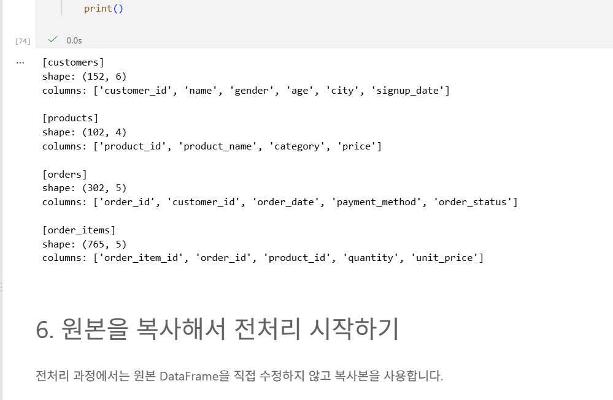
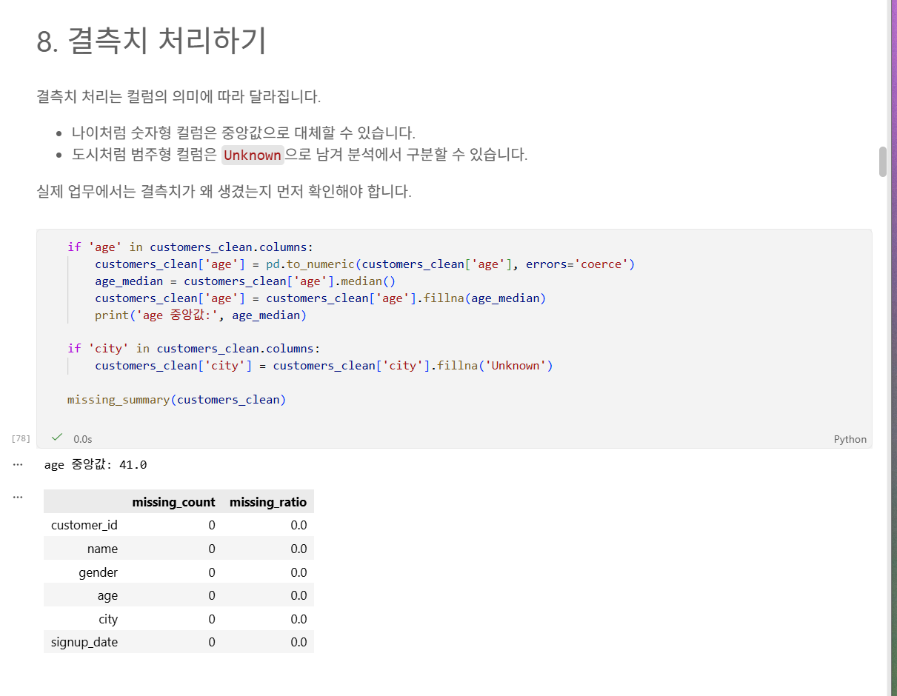
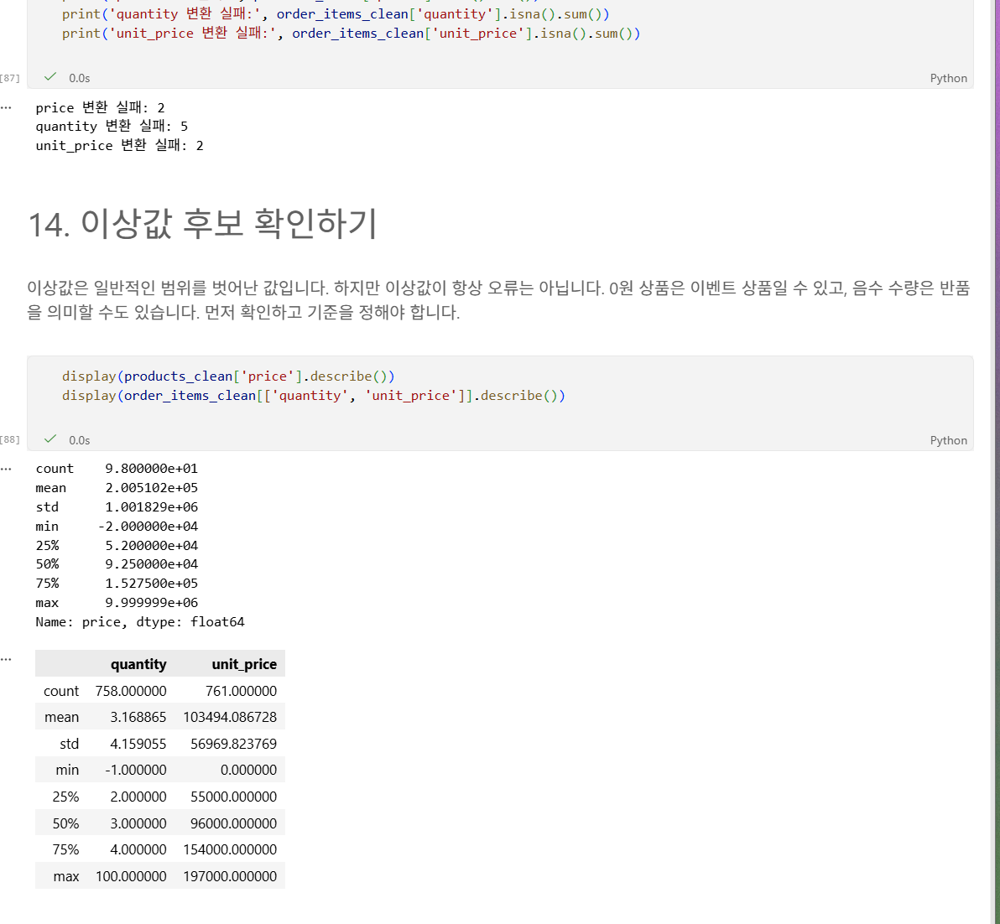
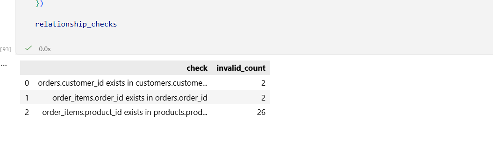
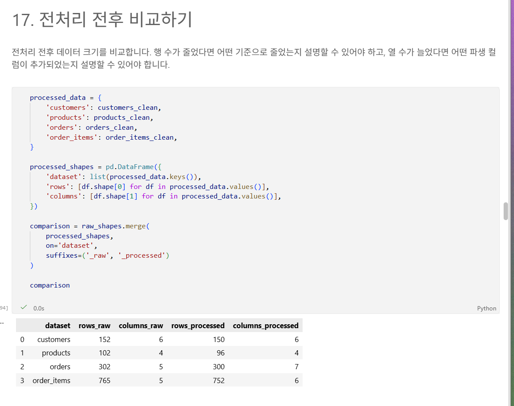
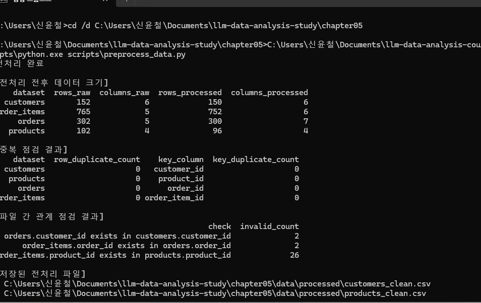

# Chapter 05 제출 답안 양식. 분석을 믿을 수 있게 만드는 데이터 전처리

> 주 제출물은 실행 완료 Notebook `chapter05/chapter05.ipynb`입니다. 이 양식의 항목은 Notebook의 Markdown 셀에도 동일하게 추가했습니다.

## 0. 제출 정보
- 이름: 신윤철
- GitHub ID: ycshin2002
- 작성일: 2026-10-13
- 최종 제출 URL: GitHub Push 후 작성

## 1. 전처리 전 상태 기록
- 각 데이터 shape: customers `(152, 6)`, products `(102, 4)`, orders `(302, 5)`, order_items `(765, 5)`
- 결측치: customers의 `age` 4건, `city` 2건
- 전체 중복: 네 파일 모두 정확히 2행씩, 총 8행
- 주요 ID 중복: `customer_id`, `product_id`, `order_id`, `order_item_id`가 각각 2건
- 타입 문제 후보: age 숫자 변환 실패 6건, price 2건, quantity 5건, unit_price 2건, 날짜 5건

### 결과 관찰
원본에는 결측치, 완전 중복 행, 숫자/날짜로 해석할 수 없는 값, 그리고 표기 방식이 다른 주문 상태가 함께 있었다.

### 나의 해석과 판단
먼저 원본을 복사한 뒤, 분석 결과를 왜곡할 가능성이 큰 완전 중복과 숫자형·날짜형 변환 실패를 점검했다. 특히 변환 실패를 단순히 0으로 바꾸면 실제 오류와 정상값을 구분할 수 없으므로 실패 건수를 별도로 확인했다.

### 업무·분석적 의미
원본 상태를 기록해 두어야 이후 행 수나 매출 금액이 변했을 때 전처리의 영향인지 실제 현상인지 구분할 수 있다.

### 한계와 추가 확인 사항
중복 ID가 모두 완전 중복 행인지, 혹은 서로 다른 이력이 우연히 같은 ID를 사용한 것인지는 운영 원본에서 추가 확인해야 한다.

## 2. 문자열·타입·결측 처리
- 적용한 문자열 정리: 모든 object 컬럼의 앞뒤 공백 제거
- 숫자 변환 대상과 실패 건수: age 6건, price 2건, quantity 5건, unit_price 2건
- 날짜 변환 대상과 실패 건수: signup_date 2건, order_date 3건
- 결측 처리 기준: age는 중앙값 41로 대체하고 city는 `Unknown`으로 대체; 해석 불가능한 날짜는 `NaT`로 보존

### 결과 관찰
age와 city의 원래 결측 6건은 처리됐지만, 잘못된 날짜 문자열 5건은 날짜 변환 후 `NaT`로 남았다. 주문 데이터에는 `completed`, `complete`, `Complete`, 한글 표기 등 여러 상태값이 있었다.

### 나의 해석과 판단
age는 대표값이 필요한 기본 인구통계 변수라 중앙값을 썼고, city는 임의 지역을 만들지 않기 위해 `Unknown`으로 분리했다. 날짜 오류는 원인을 알 수 없으므로 삭제하거나 임의 날짜로 대체하지 않고 결측으로 표시했다.

### 업무·분석적 의미
상태값을 통일해야 완료·취소·환불별 집계가 일관되며, 숫자형 변환을 마쳐야 가격과 주문 금액을 신뢰성 있게 계산할 수 있다.

### 한계와 추가 확인 사항
중앙값 대체는 연령 분포를 좁힐 수 있고, `Unknown` 도시는 지역별 분석에서 별도 집단으로 해석해야 한다. 날짜 오류는 수집 시스템 또는 입력 규칙을 확인해 수정해야 한다.

## 3. 중복·범주 표준화·이상값 후보
- 제거/보류한 중복: 완전 중복 8행 제거; ID는 중복이 0건인지 재검증
- 표준화한 범주값: 주문 상태를 `completed`, `cancelled`, `refunded`로 통일
- 허용값 밖 값: price 0 이하 또는 숫자 변환 실패 4건, quantity 0 이하 또는 변환 실패 8건, unit_price 0 이하 또는 변환 실패 3건
- 이상값 후보: `line_total` 15,500,000원 같은 매우 큰 주문 금액과 비정상 날짜 5건

### 결과 관찰
products는 102행에서 96행, order_items는 765행에서 752행으로 줄었다. 이는 중복 제거 후 가격·수량·단가가 분석에 사용할 수 없는 행을 제외한 결과다.

### 나의 해석과 판단
0 이하 또는 숫자가 아닌 가격·수량·단가는 매출 계산의 의미가 불명확해 분석 대상에서 제외했다. 다만 큰 주문 금액은 실제 대량 구매일 수 있으므로 자동 삭제하지 않고 후보로만 표시했다.

### 업무·분석적 의미
범주 표준화와 계산 불가능한 값 처리는 집계 오류를 막지만, 제거된 행의 사유를 남겨야 결과를 재현하고 설명할 수 있다.

### 한계와 추가 확인 사항
이상값은 오류가 아니라 중요한 고객 또는 특수 주문일 수 있다. 업무 맥락, 할인·반품·대량 주문 여부를 확인한 뒤 처리 기준을 확정해야 한다.

## 4. PK/FK와 파생 컬럼 재검증
- 없는 `customer_id`: 전처리 후 2건
- 없는 `order_id`: 전처리 후 2건
- 없는 `product_id`: 전처리 후 26건
- 생성한 파생 컬럼: `order_month`, `order_dayofweek`, `line_total`
- `line_total` 검증: `quantity × unit_price`와 불일치 0건, 결측 0건, 합계 252,140,000원

### 결과 관찰
원본부터 존재하지 않는 고객 ID 2건과 주문 ID 2건이 있었다. 상품 전처리에서 가격이 잘못된 상품 4개를 제외하면서, 해당 상품을 참조하던 order_items까지 포함해 product FK 불일치가 26건으로 늘어났다.

### 나의 해석과 판단
전처리 자체가 참조 무결성에 영향을 줄 수 있으므로, 데이터 타입과 이상값만 정리한 뒤에도 PK/FK를 다시 확인해야 한다. 여기서는 불일치 행을 조용히 삭제하지 않고 별도 문제로 보류했다.

## 5. 전처리 전/후 비교
| 항목 | 처리 전 | 처리 후 | 변화 이유 |
| --- | ---: | ---: | --- |
| 전체 행 수 | 1,321 | 1,298 | 완전 중복 8행과 분석 불가능한 상품·주문상세 15행을 제거 |
| 원본 결측 | 6건 | age·city 0건 | age 중앙값, city `Unknown` 처리 |
| 전체 중복 | 8건 | 0건 | 완전 중복 행 제거 |
| 변환 실패 | 숫자 15건, 날짜 5건 | 숫자 오류 행 제외·날짜 5건은 `NaT` 보존 | 계산 오류를 막고 날짜 오류를 추적하기 위함 |

### 결과 관찰
customers는 152→150, products는 102→96, orders는 302→300, order_items는 765→752행이 됐다. orders에는 파생 컬럼 2개, order_items에는 `line_total` 1개가 추가됐다.

### 나의 해석과 판단
행 수 변화는 전처리 규칙별 제거 건수와 대조해 확인했다. 단, 날짜 파싱 실패는 삭제하지 않아 변환 뒤 결측처럼 보이는 값이 남는 것이 의도한 결과다.

### 업무·분석적 의미
전후 비교표는 전처리가 분석 표본을 얼마나 바꾸었는지 보여 주며, 이후 EDA에서 결과가 달라졌을 때 원인을 추적하는 기준이 된다.

### 한계와 추가 확인 사항
가격 오류 상품을 제거한 결과 product FK 불일치가 증가했으므로, 후속 분석에서는 해당 26건을 제외할지 원본 가격을 복구할지 별도 기준을 정해야 한다.

## 6. 재현 가능한 전처리 확인
- 생성된 clean CSV: `data/processed/customers_clean.csv`, `products_clean.csv`, `orders_clean.csv`, `order_items_clean.csv`
- 생성된 요약 보고서: `reports/ch05_preprocessing_summary.md`
- `python scripts/preprocess_data.py` 재실행 결과: 네 clean CSV와 요약 보고서가 같은 규칙으로 다시 생성됨
- 재실행 후 달라진 점: 원본 raw CSV는 변경되지 않았고, processed 파일과 report만 갱신됨

### 나의 해석과 판단
Notebook에서 한 번 성공한 결과는 셀 실행 순서나 수동 조작에 의존할 수 있다. 반면 스크립트는 입력·처리 규칙·출력을 고정하므로 다른 사람이 같은 원본으로 같은 결과를 재생성할 수 있다.

## 7. Chapter 05 최종 판단
### 내가 정한 전처리 원칙 3가지
1. 원본 raw 파일은 수정하지 않고 복사본과 processed 파일을 분리한다.
2. 변환 실패와 이상값은 먼저 수치화해 확인하고, 업무 근거 없이 임의로 정상값으로 바꾸지 않는다.
3. 행을 제거하거나 키 값을 바꾼 뒤에는 PK/FK와 파생 계산을 반드시 다시 검증한다.

### 가장 위험하다고 생각한 자동 처리 1가지와 이유
가격 오류 상품을 자동으로 삭제하는 처리다. 상품 행 하나를 지워도 이를 참조하는 주문상세가 남아 관계 오류가 커질 수 있으므로, 연관 행과 업무 규칙을 함께 결정해야 한다.

### 다음 EDA에서 특히 주의할 데이터 특성
취소·환불 주문을 매출에 포함할지, `NaT` 날짜 주문을 월별 분석에서 어떻게 다룰지, product FK 불일치 26건을 어떻게 처리할지 명시해야 한다.

### 현재 전처리의 한계
오류값의 실제 원인과 참조 무결성 문제를 자동으로 해결하지는 않았다. 이 노트북은 문제를 드러내고 재현 가능한 기본 정리를 수행한 상태다.

## 최종 제출 체크
- [x] raw 원본을 덮어쓰지 않았습니다.
- [x] 처리 전/후 비교를 남겼습니다.
- [x] 처리 기준과 이유를 자신의 말로 작성했습니다.
- [x] clean CSV와 재실행 결과를 확인했습니다.
- [x] 개인정보/Secret이 없습니다.
- [ ] `chapter05/chapter05.ipynb`가 GitHub에서 정상 표시됩니다.
- [ ] 최종 Notebook 파일 URL을 제출합니다.
