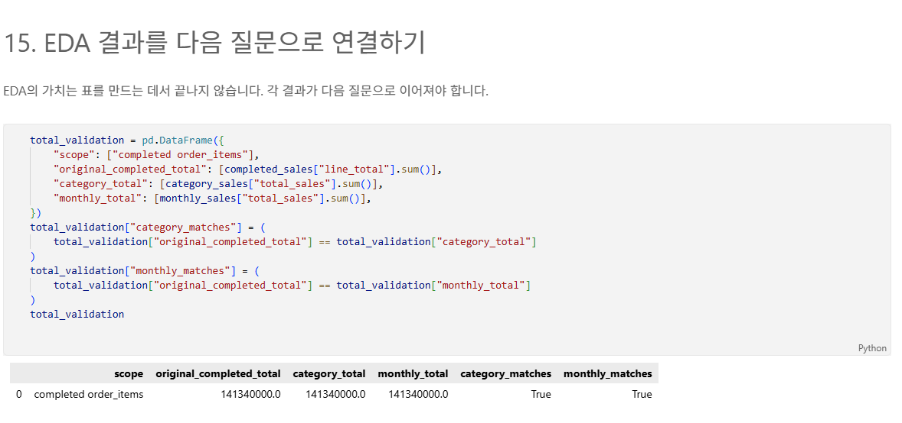
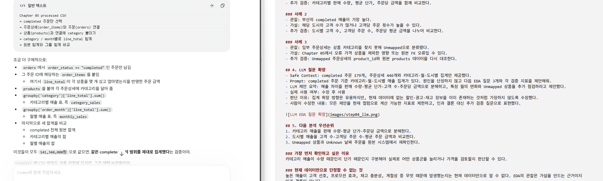

# Chapter 06 답안 양식. 데이터를 보며 질문을 만드는 EDA

> 이 내용은 공식 템플릿에 맞춰 chapter06.ipynb의 Markdown 셀에도 작성했습니다.

## 제출 정보
- 이름: 신윤철
- GitHub ID: ycshin2002
- 작성일: 2026-10-19
- 최종 Notebook URL: GitHub Push 후 작성

## 1. 내가 정한 EDA 질문
| 질문 | 분석 범위 | 지표 | 검증 방법 |
| --- | --- | --- | --- |
| completed 주문에서 어떤 카테고리가 매출을 가장 많이 만드는가? | completed 주문상세 전체 | 카테고리별 line_total 합계·비중 | 카테고리 합계와 원본 completed 합계 대조 |
| 월별 completed 매출은 어떻게 달라지는가? | completed 주문상세 전체, 날짜 오류는 Unknown 월로 보존 | 월별 line_total 합계·고유 주문 수 | 월별 합계와 원본 completed 합계 대조 |
| 도시별 매출 차이는 고객 수 차이인지 구매 행태 차이인지? | completed 주문을 한 고객 | 도시별 매출·고유 주문 수 | 고객 수·평균 주문금액을 추가 비교 |

### 왜 이 질문을 선택했는가?
전처리된 파일에는 주문 상태, 주문 일자, 상품 카테고리, 고객 도시, 주문상세 금액이 모두 있어 위 질문을 직접 계산할 수 있다. 금액 분석 범위는 order_status == completed로 고정했다.

## 2. 핵심 집계 결과
- completed 원본 합계: 141,340,000원, 179개 주문, 446개 주문상세
- 카테고리별 합계: 최고는 패션 32,940,000원; FK 불일치 상품은 Unmapped으로 분리
- 월별 합계: 날짜 변환 실패는 Unknown 월로 분리했으며, 각 월의 합계를 모두 더해 원본 합계와 대조
- 총합 일치 여부: 원본 completed 합계 = 카테고리 합계 = 월별 합계 = 141,340,000원으로 일치

### 결과 관찰
completed 범위에서 패션 카테고리의 매출이 가장 높다. 도시별로는 부산의 completed 매출이 가장 높다. 상품 참조가 없는 주문상세는 Unmapped으로 남겨 전체 매출에 포함했다.

### 나의 해석과 판단
매출 상위 카테고리는 판매 수량이 많거나 평균 단가가 높을 가능성이 있지만, 현재 결과만으로 어느 요인이 원인인지는 단정할 수 없다. 범주·월별 합계가 원본 합계와 일치하므로 동일 범위를 사용한 집계라는 점은 확인됐다.

### 업무·분석적 의미
매출이 큰 카테고리와 도시를 우선 관찰 대상으로 삼을 수 있으며, 다음 분석에서는 수량·단가·주문 횟수를 분리해 검토할 수 있다.

### 한계와 추가 확인 사항
주문 수가 적은 집단의 매출은 큰 한 건의 주문에 좌우될 수 있다. 할인, 마케팅 노출, 재고 정보가 없어 매출 차이의 원인을 설명할 수는 없다.

## 3. 관찰 → 가설 → 추가 검증
### 사례 1
- 관찰: 패션가 completed 매출 1위다.
- 가설: 판매 수량이 많거나 평균 단가가 다른 카테고리보다 높을 수 있다.
- 추가 검증: 카테고리별 판매 수량, 평균 단가, 주문당 금액을 함께 비교한다.

### 사례 2
- 관찰: 부산의 completed 매출이 가장 높다.
- 가설: 해당 도시의 고객 수가 많거나 고객당 주문 횟수가 높을 수 있다.
- 추가 검증: 도시별 고객 수, 고객당 주문 수, 주문당 평균 금액을 나누어 비교한다.

### 사례 3
- 관찰: 일부 주문상세는 상품 카테고리를 찾지 못해 Unmapped으로 분류됐다.
- 가설: Chapter 05에서 오류 가격 상품을 제외한 영향 또는 원본 FK 오류일 수 있다.
- 추가 검증: Unmapped 주문상세의 product_id와 원본 products 데이터를 다시 대조한다.

## 4. LLM 질문 확장
- Safe Context: completed 주문 179개, 주문상세 446개와 카테고리·월·도시별 집계만 제공했다.
- Prompt: completed 주문 기준 카테고리·월·도시별 매출 집계가 있다. 원인을 단정하지 않고 다음 EDA 질문 3개와 각 검증 지표를 제안해줘.
- LLM 제안 요약: 매출 차이를 판매 수량·평균 단가·고객 수·주문당 금액으로 분해하고, 특정 월의 변화와 Unmapped 상품을 추가 점검하라고 제안했다.
- 실제 사용 여부: 수정 후 사용
- 판단 이유: 집계 확장 방향은 유용하지만, 현재 데이터에 없는 할인·광고·재고 정보를 이미 존재하는 것처럼 가정하지 않도록 수정했다.
- 사람이 수정한 내용: 모든 제안을 현재 컬럼으로 계산 가능한 지표로 제한하고, 인과 결론 대신 추가 검증 질문으로 표현했다.

## 5. 다음 분석 우선순위
1. 카테고리 매출을 판매 수량·평균 단가·주문당 금액으로 분해한다.
2. 도시별 매출을 고객 수·고객당 주문 수·평균 주문 금액과 비교한다.
3. Unmapped 상품과 Unknown 날짜 주문을 원본 시스템에서 재확인한다.

### 가장 먼저 확인하고 싶은 이유
카테고리 매출이 수량 때문인지 단가 때문인지 구분해야 실제로 어떤 상품군을 늘리거나 가격을 검토할지 판단할 수 있다.

### 현재 데이터만으로 단정할 수 없는 것
높은 매출이 고객 선호, 프로모션 효과, 재고 충분성, 계절성 중 무엇 때문에 발생했는지는 현재 데이터만으로 알 수 없다. EDA의 관찰은 가설을 만드는 근거이지 인과 결론이 아니다.

## 최종 체크
- [x] 질문과 지표가 연결되어 있습니다.
- [x] 집계 총합을 검증했습니다.
- [x] 관찰과 가설을 구분했습니다.
- [x] 다음 검증 질문을 작성했습니다.
- [x] LLM 제안을 검증했습니다.
- [ ] 최종 Notebook URL을 제출합니다.
