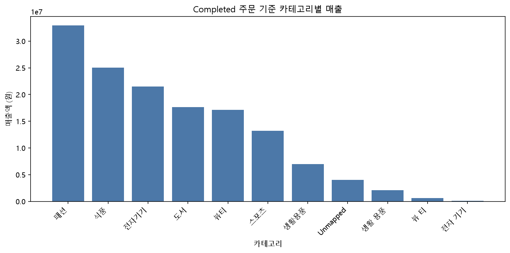
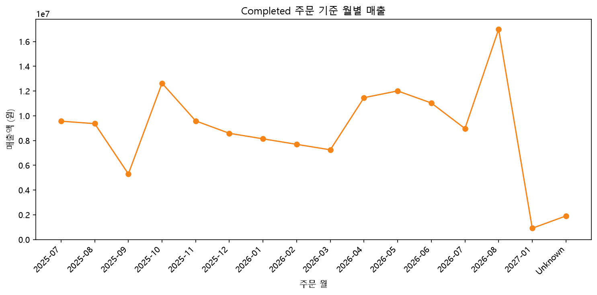
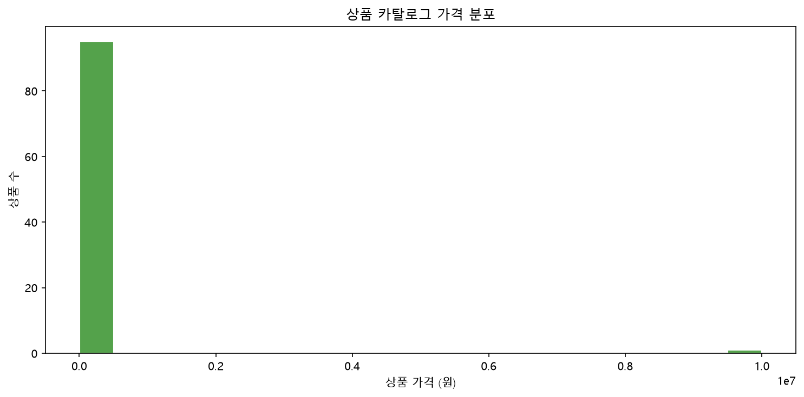

# 제출 답안

## 제출 정보
- 이름: 신윤철
- GitHub ID: ycshin2002
- 작성일: 2026-10-20
- 최종 Notebook URL: `https://github.com/ycshin2002/llm-data-analysis-study/blob/main/chapter07/chapter07.ipynb`

## 1. 시각화 질문과 그래프 선택
| 질문 | 선택한 그래프 | 선택 이유 |
| --- | --- | --- |
| Completed 주문에서 어떤 카테고리가 매출을 가장 많이 만드는가? | 막대그래프 | 범주별 매출 크기를 같은 기준선에서 비교하기 좋다. |
| Completed 주문 매출은 월별로 어떻게 달라지는가? | 선그래프 | 시간 순서에 따른 변화와 일시적 고점을 확인하기 좋다. |
| 상품 가격은 어떤 분포를 가지는가? | 히스토그램 | 가격이 어느 구간에 몰려 있고 극단값 후보가 있는지 확인하기 좋다. |

## 2. 대표 그래프 1: 카테고리별 매출

### 원본 집계값
`category_sales`를 사용했으며, completed 주문 항목 446건의 매출 합계는 141,340,000원이다. 식품 카테고리가 32,940,000원으로 가장 높다.

### 결과 관찰
카테고리별 매출 차이가 있으며, 식품·생활용품·전자기기가 상위권이다.

### 나의 해석과 판단
상위 카테고리의 매출 우위는 확인되지만, 판매 수량·상품 가격·상품 수가 함께 작용할 수 있으므로 이것만으로 수요가 높다고 단정하지 않는다.

### 업무·분석적 의미
상위 카테고리는 상품별 매출과 판매 수량을 추가로 확인할 우선 후보이다.

### 한계와 추가 확인 사항
카테고리 표기 정제 과정에서 `Unmapped`가 남아 있으며, 이를 원래 카테고리에 재분류할 수 있는지 확인해야 한다.

## 3. 대표 그래프 2: 월별 매출

### 원본 집계값
`monthly_sales`를 사용했으며, 월별 합계와 카테고리별 합계는 모두 141,340,000원으로 원본 completed 매출 합계와 일치한다.

### 결과 관찰
2026-08의 월별 매출이 16,980,000원으로 가장 높으며, 2025-09는 5,299,000원으로 낮다.

### 나의 해석과 판단
월별 차이는 사실이지만, 기간 중 주문 수·상품 구성·프로모션 정보가 없으므로 계절성이나 특정 이벤트의 효과라고 결론 내릴 수 없다.

### 업무·분석적 의미
고점과 저점 월의 주문 수 및 카테고리 구성을 비교하면 변동의 후보 원인을 좁힐 수 있다.

### 한계와 추가 확인 사항
날짜 오류 2건은 `Unknown`으로 분리했다. 또한 2027-01은 관측 기간이 짧을 수 있어 다른 월과 단순 비교하면 안 된다.

## 4. 대표 그래프 3: 상품 가격 분포

### 원본 집계값
`products` 96개 상품의 가격을 사용했다. 중앙값은 94,500원, 최댓값은 9,999,999원이다.

### 결과 관찰
대부분 상품 가격은 낮은 구간에 있고, 고가 쪽으로 긴 꼬리와 극단값 후보가 보인다.

### 나의 해석과 판단
고가 상품은 실제 프리미엄 상품일 수도, 입력 오류일 수도 있으므로 분포만으로 제거하면 안 된다.

### 업무·분석적 의미
상위 가격 상품의 상품명·카테고리·주문 여부를 확인해 가격 정책 또는 데이터 품질 이슈를 구분할 수 있다.

### 한계와 추가 확인 사항
이 그래프는 판매된 상품만이 아니라 전체 상품 카탈로그의 가격 분포다. 매출 분석 범위와 다름을 명시했다.

## 5. 그래프 정확성 점검
- [x] 그래프 값과 집계표 값 일치
- [x] 축 이름 확인
- [x] 단위 확인
- [x] 범례 확인 불필요(단일 계열)
- [x] 날짜 정렬 확인
- [x] 과장될 수 있는 축 범위 확인
- [x] 제목이 분석 범위를 정확히 표현

### 내가 발견한 시각화 위험 또는 개선점
금액 그래프는 0에서 시작하는 축을 사용해 차이를 과장하지 않았다. 월별 그래프의 `Unknown`과 관측 기간이 짧을 수 있는 2027-01은 원인 해석에서 제외 또는 별도 표기해야 한다.

## 6. Chapter 07 최종 판단
### 가장 중요한 그래프 1개와 이유
카테고리별 매출 막대그래프가 가장 중요하다. completed 매출이 어디에 집중되는지 빠르게 보여 주고, 후속 상품·수량 분석의 출발점이 된다.

### 그래프가 보여 준 사실
완료 주문 기준 매출은 카테고리와 월에 따라 다르며, 상품 가격 분포에는 고가 극단값 후보가 있다.

### 그래프만으로 말할 수 없는 것
그래프만으로 매출 차이의 원인, 인과관계, 미래 매출을 말할 수 없다.

### 다음 분석에서 확인할 질문
상위 카테고리 매출은 판매 수량 증가, 고가 상품 판매, 또는 상품 수 차이 중 무엇에 더 크게 좌우되는가?
