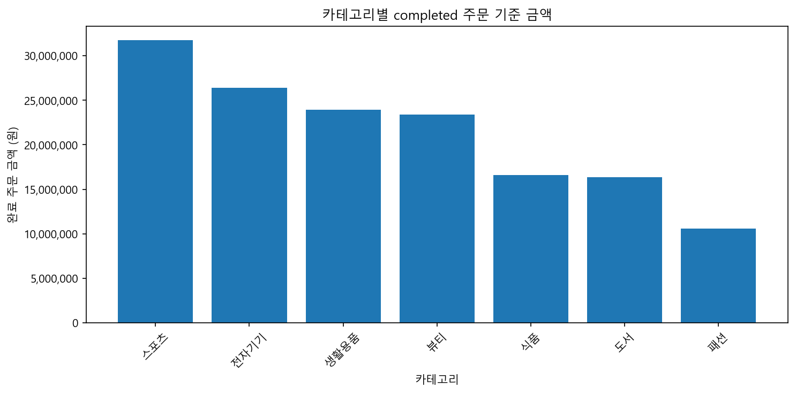
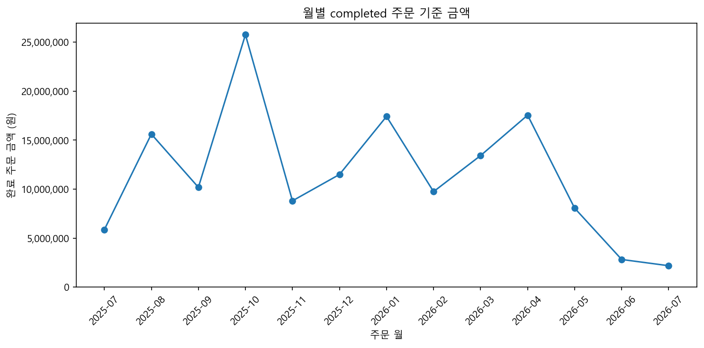

# 제출 답안: Chapter 08 작은 데이터 분석 프로젝트

## 제출 정보
- 이름: 신윤철
- GitHub ID: ycshin2002
- 작성일: 2026-11-04
- 최종 Notebook URL: https://github.com/ycshin2002/llm-data-analysis-study/blob/main/chapter08/chapter08.ipynb

## 1. 프로젝트 질문
### 분석 질문
1. 카테고리별 completed 주문 금액과 비중은 어떻게 다른가?
2. 월별 completed 주문 금액과 고유 주문 수는 어떻게 변하는가?
3. completed 구매 금액 상위 익명 고객은 구매 횟수와 주문당 금액에서 어떤 특징을 보이는가?
### 분석 범위
공식 공개 저장소의 가상 쇼핑몰 원본 4개 파일을 사용한다. 전체 주문의 관측 날짜는 2025-07-09~2026-07-08이다. 금액·고객 분석은 completed 주문만 포함하고, 주문 상태 분포만 전체 orders를 사용한다. 금액은 원 단위이며 회계상 순매출이나 이익을 뜻하지 않는다.
### 사용할 데이터와 지표
customers, products, orders, order_items를 사용한다. 금액 합계, 금액 비중, 고유 주문 수, 고객별 주문당 평균 금액을 계산한다. 주문 수는 상세 행 수가 아니라 order_id.nunique()이다.
### 계산 기준
- `order_status == "completed"`: 적용함(184개 주문, 474개 상세 행).
- `line_total = quantity × unit_price`: 764개 상세 행에서 검증, 불일치 0건.
### 완료 기준
PK 결측·중복 0, FK 미매칭 0, 병합 행 수 보존, 계산 불일치 0, 날짜 오류 0, 네 금액 총합 일치, 공개 고객 결과 금지 컬럼 없음, 최종 Validation 8개 PASS 및 별도 재실행 결과 일치를 완료 기준으로 삼았다.

## 2. 입력 데이터와 전처리 검증
- 원본: `data/raw/customers.csv`, `products.csv`, `orders.csv`, `order_items.csv`.
- shape: 고객 (150, 6), 상품 (100, 4), 주문 (300, 5), 상세 (764, 5).
- 결측·완전 중복: 4개 원본 파일 모두 0건.
- 전처리 전후 행 수: 고객 150→150, 상품 100→100, 주문 300→300, 상세 764→764.
- 주문 열은 월·요일 파생 변수로 5→7개, 상세 열은 line_total 생성으로 5→6개가 됐다. 숫자·날짜형 변환과 문자열 앞뒤 공백 정리를 적용했다. 행 삭제·결측 대체는 이번 원본에서는 발생하지 않았다.

입력 검증 표는 본문 **3. 원본 데이터 확인 / 4. 원본을 보존하며 전처리** 출력에 있다. 직접 캡처한다면 `../images/step02_data_validation.png`로 저장한다.
### 나의 해석과 판단
이번 원본은 기본 결측·중복이 없으므로 불필요한 행 삭제를 하지 않았다. 전처리 코드를 실행했다는 사실과 실제로 행이 변했다는 사실을 구분했다. 원본 파일 SHA-256도 별도 재검증했다.
### 한계와 추가 확인 사항
학습용 가상 데이터이므로 실제 쇼핑몰의 대표성을 보장하지 않는다. 이전 Chapter 05의 오염된 샘플이 아닌 최신 공식 data/raw를 사용했으므로 과거 챕터의 숫자와 직접 비교하지 않는다. 구조 검증 PASS가 현실의 기록 정확성까지 보장하지 않는다.

## 3. PK/FK·병합 검증
### PK 결과
customer_id, product_id, order_id, order_item_id의 결측·중복은 각각 0건이고 4개 모두 PASS다.
### FK 결과
orders→customers, order_items→orders, order_items→products의 미매칭은 각각 0건이고 모두 PASS다.
### 병합 결과
| 관계 | validate | 병합 전→후 | 미매칭 | 결과 |
| --- | --- | --- | --- | --- |
| 상세→주문 | many_to_one | 764→764 | 0 | PASS |
| completed 상세→상품 | many_to_one | 474→474 | 0 | PASS |
| 고객 집계→고객 | one_to_one | 100→100 | 0 | PASS |
### 나의 해석과 판단
키 중복으로 행이 늘어나거나 연결 누락으로 금액이 사라지는 문제가 없는지 확인했다. left merge의 실행 성공만으로 안전하다고 판단하지 않았다.

## 4. 핵심 EDA 결과
### 결과 1: 카테고리별 금액
- 수치/표: `ch08_category_sales.csv`. 스포츠 31,743,000원, 전체의 21.31%로 1위다.
- 결과 관찰: 최하위 패션은 10,587,000원(7.11%)이며 범주별 금액 차이가 있다.
- 나의 해석과 판단: 스포츠의 완료 주문 금액 기여가 가장 높다. 고객 선호나 이익이 가장 높다고 해석하지 않는다.
- 업무·분석적 의미: 판매 수량과 가중평균 단가를 분리해서 조사할 우선 후보로 삼을 수 있다.
- 한계: 원가·마진·노출량·재고가 없어 수익성이나 판매 효율을 평가할 수 없다.
### 결과 2: 월별 금액과 주문 수
- 수치/표: `ch08_monthly_sales.csv`. 2025-10 25,766,000원, 26개 고유 주문으로 금액 1위다. 주문당 평균 금액은 991,000원이다.
- 결과 관찰: 2026-07은 2,188,000원·2개 주문이다. 관측 종료일이 7월 8일이어서 완전한 한 달이 아니다.
- 나의 해석과 판단: 2025-10은 높은 주문 수와 주문당 금액이 함께 관측된다. 마지막 달의 낮은 금액을 하락 추세로 단정하지 않는다.
- 업무·분석적 의미: 완전한 월끼리 주문 수와 주문당 금액을 분해해 비교한다.
- 한계: 시작 월도 부분 월이며, 1년 정도의 가상 데이터만으로 계절성이나 광고 효과를 말할 수 없다.
### 결과 3: 익명 고객별 구매 금액
- 수치/표: `ch08_customer_sales.csv`. Customer 01은 4,100,000원·5회 구매, 주문당 820,000원이다. 구매 고객은 100명, 상위 10명의 금액 비중은 23.29%다.
- 결과 관찰: 금액이 높은 고객도 주문 횟수와 주문당 금액은 서로 다르다.
- 나의 해석과 판단: 고액 구매와 반복 구매를 구분해야 하며 순위가 곧 충성도를 뜻하지 않는다.
- 업무·분석적 의미: 최근 구매일·반복 구매 간격을 추가로 분석할 수 있다.
- 한계: 비구매 고객, 관측 기간 외 구매, 고객의 만족도·이탈 의도는 이 집계로 알 수 없다. 순위 기반 라벨은 직접 식별자를 줄이는 조치이지 엄밀한 재식별 불가능성을 보장하지 않는다.

## 5. Total consistency와 날짜 검증
- completed source total: 148,990,000원.
- category total: 148,990,000원.
- monthly total: 148,990,000원.
- customer total: 148,990,000원.
- 총합 일치: 네 값 모두 일치, 차이 0원.
- completed 상세의 날짜 오류 0건, 영향 금액 0원.
- 전체 상세 금액은 255,610,000원이며 completed 금액과 다르다. 취소·환불 포함분 106,620,000원을 완료 금액과 혼용하지 않았다.
### 불일치가 있었다면 원인
이번 실행에서는 불일치가 없었다. 날짜를 임의로 채우거나 오류를 제외해 PASS를 만들지 않았으며 기존 공식 Gate를 유지했다.

## 6. 대표 시각화

### 그래프 선택 이유
카테고리 막대그래프는 범주별 크기 비교에, 월별 선그래프는 시간 순 변화 확인에 적합하다. 익명 고객 가로 막대그래프도 본문에 추가했다.
### 그래프와 원본 집계값 일치 여부
검증된 category_sales·monthly_sales에서 직접 그렸으며 독립 재계산으로 각 카테고리·월의 금액과 고유 주문 수를 전부 대조했다. 금액 단위는 원이고 0 기준선을 사용한다.
### 그래프에서 직접 관찰한 사실
스포츠 카테고리와 2025-10의 금액이 각각 가장 높다. 그래프 아래 본문에도 관찰·해석·한계를 분리했다.
### 그래프만으로 말할 수 없는 것
광고 효과·프로모션·고객 선호·수익성·미래 성과는 설명할 수 없다. 부분 월의 높낮이는 기간 차이를 함께 고려해야 한다.

## 7. 개인정보 검증
- 공개 고객 CSV 컬럼: customer_label, city, order_count, total_sales, avg_order_value.
- 원본 customer_id 및 name/email/phone/address: 공개 집계 CSV·고객 그래프에 없음.
- 익명 라벨: 구매 금액 순위 기반 Customer 01, Customer 02 등(원본 ID를 붙이지 않음).
- 저장된 공개 CSV를 다시 읽어 금지 컬럼 없음 확인: PASS.
### 나의 판단
제공된 원본은 가상 쇼핑몰 실습 데이터이고 실제 개인정보가 아니다. 입력의 가상 ID와 이름은 계산용 원본으로 보존하되, 노트북 출력·보고서·공개 고객 결과에는 원본 고객 행이나 ID-라벨 대응표를 출력하지 않았다. 실제 데이터라면 원본을 공개 저장소에 넣어서는 안 된다.

## 8. 최종 Validation
| 검증 항목 | 결과 | 내가 확인한 근거 |
| --- | --- | --- |
| pk_integrity | PASS | PK 결측·중복 모두 0 |
| fk_integrity | PASS | 3개 관계 미매칭 0 |
| merge_checks_pass | PASS | 관계 통과·행 수 보존·미매칭 0 |
| line_total_consistency | PASS | 764개 상세 불일치 0 |
| completed_total_consistency | PASS | 네 총합 148,990,000원, 차이 0 |
| category_sales_ratio_pct_sum | PASS | 비중 합 100.00% |
| completed_rows_with_invalid_order_date | PASS | 날짜 오류 0 |
| public_customer_columns_safe | PASS | 저장 공개 CSV 금지 컬럼 없음 |
### FAIL이 있었다면 수정 내용
공식 원본과 공식 계산 기준으로 1차 실행부터 모두 PASS였다. 필터·Gate·기대값을 약화하거나 원본 숫자를 수정하지 않았다. 로컬 편의 변경은 경로 탐색, 스크립트 실행 경로, 그래프 축 단위·0 기준선, 추가 검증과 해석 셀이다.

## 9. LLM 활용 기록
- 사용 여부/목적: AI로 코드 구성, 경로 보완, 검증 코드 및 해석 초안을 작성했다.
- Safe Context: 공식 코드·스키마·비식별 요약 통계·검증표를 사용했고 원본 고객 행·이름·ID-라벨 대응표는 제시하지 않았다.
- Prompt 요약: 공식 Chapter 08과 LMS 요구에 맞게 실행 노트북·산출물을 작성하고 수치·키·개인정보·재현성을 검증하도록 요청했다.
- 제안/반영: completed 범위 통일, PK/FK Gate, 총합 대조, 순위 라벨, 별도 프로세스 재실행을 반영했다.
- 수정/보류: 과거 챕터의 금액을 재사용하지 않고 현재 원본에서 계산했다. 마케팅·선호·충성도에 대한 인과 해석은 제외했다.
- 검증 근거: 실제 실행한 공식 Validation 8개와 독립 재계산 CSV, 별도 프로세스 출력 로그가 있다. 자동 실행·검증은 AI가 수행했으며 제출자의 수동 검토·캡처·GitHub 표시 확인은 제출 전에 별도로 수행해야 한다. 사람이 이미 검수했다고 기재하지 않았다.

## 10. 프로젝트 재현 확인
- chapter08 폴더를 기준으로 `python scripts/run_midterm_project.py` 실행: Notebook **15. 전체 파이프라인 재실행**에서 동일 Python의 별도 프로세스로 실행함.
- 결과: 종료 코드 0, 공식 Validation 8개 PASS.
- Notebook과 재실행 CSV: 핵심 집계표 전부 대조, 값 일치.
- 독립 검증: `python scripts/verify_project.py`로 원본 해시, 카테고리·월·고객 금액, 월별 고유 주문 수, 공개 컬럼·라벨을 별도 계산으로 확인했다.
- 생성 파일: 공식 19개 CSV·PNG·Markdown이 모두 존재하고 비어 있지 않음.

재실행 화면은 본문 **15. 전체 파이프라인 재실행** 출력에 있다. 직접 캡처한다면 `../images/step06_reproduce.png`로 저장한다.
### 나의 해석과 판단
같은 커널에서 셀을 재실행하는 것과 별도 프로세스에서 원본부터 계산하는 것을 구분했다. 재현성은 메모리에 남은 이전 변수에 기대지 않고 같은 입력과 기준으로 같은 결과를 얻는 성질이다.

## 11. 최종 프로젝트 요약
### 핵심 인사이트 3개
1. 스포츠의 완료 금액은 31,743,000원(21.31%)으로 가장 높다. 수량·단가를 추가로 분해할 우선 후보이며, 수익성이 가장 높다는 뜻은 아니다.
2. 2025-10의 25,766,000원·26개 주문은 월별 금액 최고점이다. 주문 수와 주문당 금액을 함께 봐야 하며, 부분 월이나 광고 원인과 혼동하지 않아야 한다.
3. 상위 10명은 완료 금액의 23.29%를 차지한다. 반복 구매와 고액 일회성 구매를 구분할 가치가 있으나, 미래 충성도나 이탈을 예측할 근거는 아니다.
### 가장 중요한 업무·분석적 의미
어떤 범주·기간·고객에 금액이 모였는지를 같은 기준으로 확인하고, 원인 검증이 필요한 다음 질문을 정할 수 있다.
### 현재 분석의 한계
가상 데이터, 짧고 부분 월을 포함한 관측 기간, 원가·광고·재고·노출량 부재가 한계다. PASS는 정의한 구조·수치 검증의 통과이지 현실 타당성이나 인과관계의 증명이 아니다.
### 다음 분석 제안
1. 카테고리 금액을 판매 수량과 가중평균 판매 단가로 분해한다.
2. 완전한 월만 골라 주문 수와 주문당 평균 금액을 비교한다.
3. 최근 구매일·반복 간격을 포함해 고액 구매와 반복 구매를 구분한다.

## 최종 체크
- [x] 질문·범위·지표를 정의하고 원본부터 다시 실행했다.
- [x] PK/FK·병합·금액·날짜·공개 컬럼을 검증했다.
- [x] 카테고리/월/고객 총합이 source와 일치한다.
- [x] 그래프와 집계값을 대조하고 관찰·해석·한계를 구분했다.
- [x] 공식 Validation 8개 PASS, 독립 재계산 및 별도 프로세스 재실행을 확인했다.
- [ ] 제출자 수동 검토 및 필요한 화면 캡처를 완료했다.
- [ ] GitHub에서 최종 Notebook 표시를 확인하고 파일 URL을 LMS에 제출했다.
